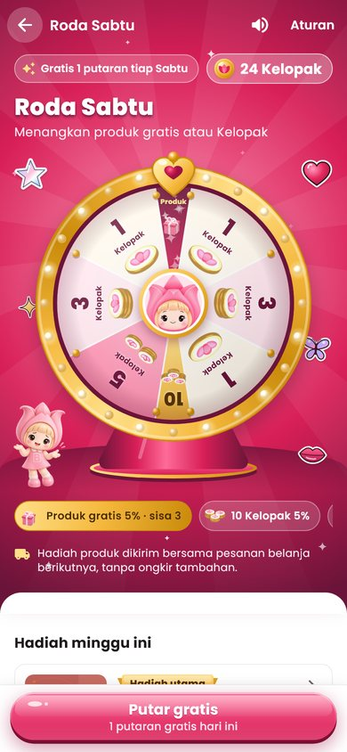
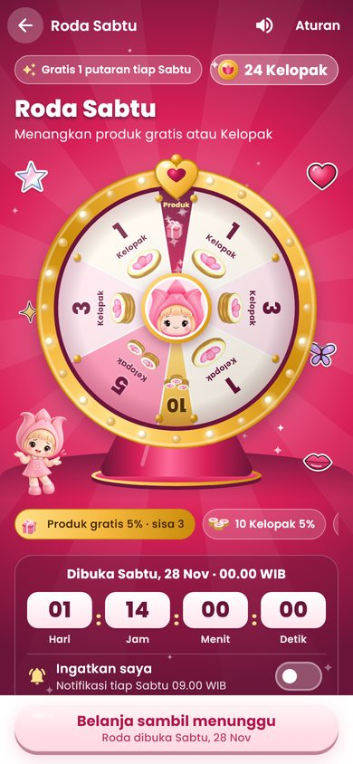
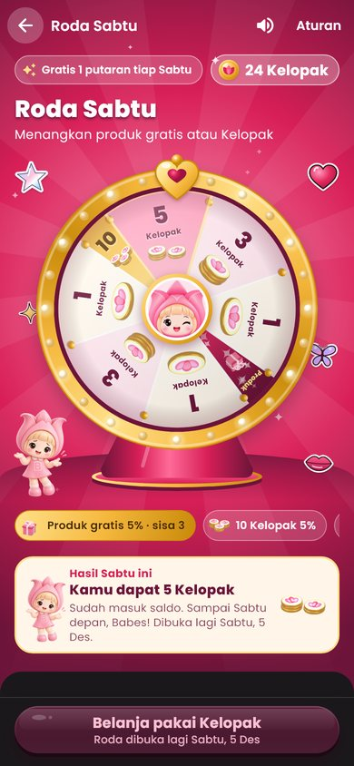
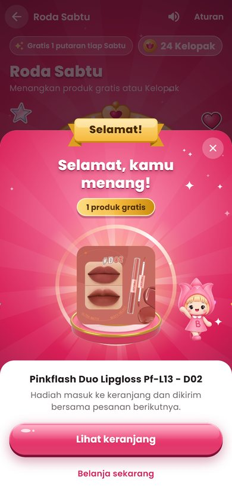
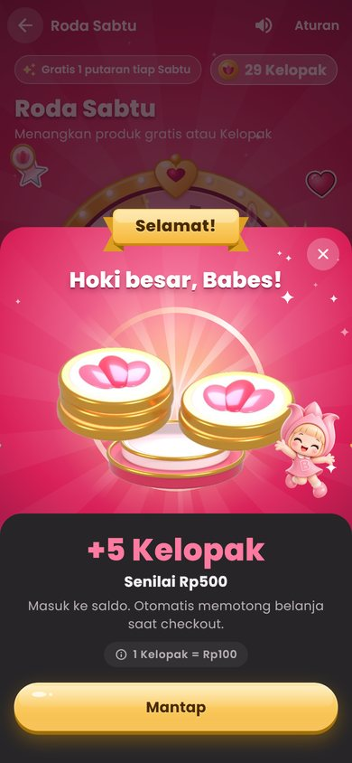
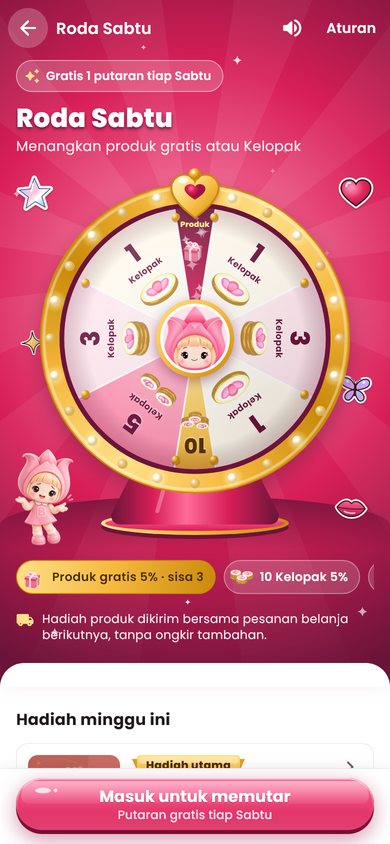
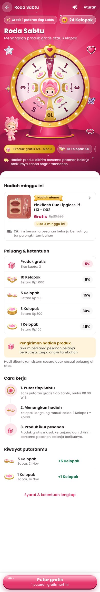

# roda_sabtu · Roda Sabtu v3

Modul Flutter untuk game hadiah **Roda Sabtu** di Bpedia Demo v3: satu putaran gratis tiap Sabtu (WIB), hadiah produk gratis (sesuai kuota) atau Kelopak, dengan peluang, sisa kuota, dan ketentuan pengiriman yang terlihat sebelum memutar.

- Hanya bergantung pada Flutter SDK (tanpa plugin). Suara dan getar lewat `GameCue` yang diputar host.
- Pola: aturan murni → `WheelViewState` tak-berubah → `WheelController` abstrak (`ChangeNotifier`) → `WheelPage`. Halaman tidak tahu sumber data.
- `LocalWheelController` (memori) untuk contoh, tes, dan pratinjau.

| Sabtu siap putar | Gelap | Hitung mundur | Sudah putar |
|---|---|---|---|
|  |  |  |  |

| Menang produk | Menang Kelopak | Tamu | Halaman penuh |
|---|---|---|---|
|  |  |  |  |

Strip animasi: [putaran 6 detik](docs/shots/roda_strip_putar.jpg) dan [perayaan menang](docs/shots/roda_strip_menang.jpg).

## Pasang

```yaml
dependencies:
  roda_sabtu:
    path: ../bpedia-roda-sabtu
```

Aset modul (`assets/bipy/`, `assets/art/`, `assets/fx/`) dirujuk dengan `package: 'roda_sabtu'`, jadi host tidak perlu mendaftarkannya. Font mengikuti tema host (Bpedia memakai Poppins).

## Pakai

```dart
import 'package:roda_sabtu/roda_sabtu.dart';

final controller = LocalWheelController(
  balance: 24,
  productQuotaLeft: 3,
  product: const WheelPrizeProduct(
    code: 'P21P03C01000082',
    name: 'Pinkflash Duo Lipgloss Pf-L13 - D02',
    image: AssetImage('assets/products/P21P03C01000082.webp'),
    price: 23230,
  ),
  soundOn: true,
);

Navigator.of(context).push(MaterialPageRoute<void>(
  builder: (_) => WheelPage(controller: controller),
));
```

Host sungguhan (mis. `kelopak_hub`) membuat subkelas `WheelController` di atas mesinnya sendiri: isi `state`, jalankan `spin()` di server atau mesin lokal, dan teruskan navigasi (`openLogin`, `openShop`, `openCart`, `openProduct`, `openTerms`), pengingat, dan suara.

## API publik

### Keadaan dan pengendali (`wheel_view.dart`)

```dart
int wheelWibDayOf(DateTime instant);

final class WheelPrizeProduct {
  const WheelPrizeProduct({required String code, required String name,
      required ImageProvider image, required int price, int? strikePrice});
}

final class WheelSpinRecord {
  const WheelSpinRecord({required int day, required String prizeId, required String label,
      required PrizeKind kind, int kelopak = 0, String? productName});
  factory WheelSpinRecord.fromPrize(SpinPrize prize, {required int day, String? productName});
  String get dayLabel; String get title;
}

final class WheelViewState {
  const WheelViewState({required bool signedIn, required int today, required SpinConfig config,
      required int productQuotaLeft, bool promoActive = true, int? lastSpinDay, int balance = 0,
      WheelPrizeProduct? product, List<WheelSpinRecord> history = const [],
      bool reminderSupported = false, bool reminderOn = false, bool? soundOn, bool busy = false});
  const WheelViewState.guest({required int today, required SpinConfig config,
      required int productQuotaLeft, bool promoActive = true, WheelPrizeProduct? product,
      bool reminderSupported = false, bool? soundOn});
  SpinEligibility get eligibility;   bool get canSpin;
  List<SpinOdds> get odds;           List<WheelSlice> get slices;
  int get nextSaturday;              WheelOpening openingAt(DateTime now);
  WheelSpinRecord? get thisWeekSpin; WheelViewState copyWith({...});
}

final class WheelSpinResult {
  const WheelSpinResult({required SpinPrize prize, required int landingSeed,
      required int balance, WheelPrizeProduct? product});
}

abstract class WheelController extends ChangeNotifier {
  WheelViewState get state;
  DateTime now();                         // bawaan DateTime.now()
  Future<void> refresh();
  Future<WheelSpinResult?> spin();        // null = tidak tersedia; lempar = gagal kirim
  void openLogin(); void openShop(); void openCart();
  void openProduct(String code); void openTerms();
  Future<void> setReminder(bool on) async {}
  void playCue(GameCue cue) {}
  void setSoundOn(bool value) {}
}
```

`LocalWheelController({SpinConfig config = demoSpinConfig, DateTime Function() clock = DateTime.now, bool signedIn = true, bool promoActive = true, int balance = 0, int productQuotaLeft = 3, int? lastSpinDay, List<WheelSpinRecord> history = const [], WheelPrizeProduct? product, bool reminderSupported = true, bool reminderOn = false, bool? soundOn, Duration latency = Duration.zero, Random? random, void Function(String)? onOpen})` plus pembantu panel uji: `setTimeOffset`, `signIn`, `signOut`, `setPromoActive`, `setProductQuota`, `resetSpin`, `forceNextPrize`, `opened`, `cues`.

### Halaman dan widget

| Kelas | Isi |
|---|---|
| `WheelPage({required WheelController controller, VoidCallback? onBack, bool ambientMotion = true})` | Halaman lengkap SPEC-V3 §6.2. `onBack` bawaan `Navigator.maybePop`; selama berputar kembali meminta konfirmasi. `WheelPage.resultDelay` = 900 ms. |
| `PrizeWheel({required odds, required resultPrizeId, required spinToken, required landingSeed, layout, onSettled, onPegPassed, centerChild, skipAnimation, duration, idleSemanticsValue, ambientMotion, maxSide = 360})` | Roda 3D. Ubah `spinToken` untuk memutar menuju `resultPrizeId`; `onSettled` tepat sekali; `onPegPassed` paling sering tiap 45 ms. `PrizeWheel.sideFor`, `heightFor`, `discKey`. |
| `WheelSpinCurve` | Kurva putaran: percepat 0,4 dtk, laju penuh 1,2 dtk, melambat 4 dtk (`easeOutQuart`), mengendap 0,25 dtk (lewat 2 derajat). |
| `OddsTable({required odds, required productStock, required shippingNote, showTitle = true})` | Tabel peluang lengkap, kuota, pengiriman, catatan keadilan (`oddsFairnessNote`). |
| `OddsStrip({required odds, required productStock, onOpenDetails, padding})` | Chip peluang di hero, `OddsStrip.chipLabel`. |
| `WheelCountdown({required saturday, required now, showReminder, reminderOn, onReminderChanged})` | Ubin hari:jam:menit:detik + sakelar "Ingatkan saya". |
| `WheelPrizeCard`, `WheelHowItWorks`, `WheelHistoryList`, `LivelyPose` | Kartu hadiah minggu ini, cara kerja, riwayat, pose Bipy yang hidup. |
| `WheelArt`, `WheelSprites` | Aset modul: koin dan tumpukan koin, kado, podium, wajah dan pose Bipy, stiker, sprite menari dan ngintip. |

### Aturan murni

`SpinConfig`, `SpinPrize`, `SpinOdds`, `effectiveOdds`, `resolveSpin`, `demoSpinConfig` (nilai demo v3), `WheelSlice`, `buildWheelSlices`, `WheelGeometry`, `WheelOpening`, `nextSpinSaturday`, `wheelOpening`, `spinEligibility`, `isSaturdayWib`, `daysUntilSaturday`, pemformat `formatRupiah`, `weekdayName`, `shortDateLabel`, `countdownLabel`. Rinciannya di `CHANGELOG.md` 3.0.0 (aturan) dan `server/spin.php` (padanan PHP).

## Perilaku penting

- Hasil ditentukan sebelum animasi (undian 0..9999). Roda hanya menampilkan hasil dan berhenti di dalam irisan hasil (15–85% lebar irisan), tidak pernah di garis batas.
- Saldo, riwayat, dan kartu hasil tidak membocorkan hasil selama roda berputar.
- Tamu: halaman tetap tampil; tombol utama "Masuk untuk memutar".
- Kurangi gerak (`MediaQuery.disableAnimations`): roda langsung di hasil, lampu dan Bipy diam, lembar hasil naik setelah 300 ms.
- Suara: `spinStart`, `tick` (dibatasi 20/dtk), `winKelopak` atau `winProduct`, `softError`. Getar ditangani kit.
- Hasil diumumkan ke pembaca layar; tabel peluang menjadi alternatif non-visual roda.
- Teks tahan skala 200% pada lebar 360 (diuji untuk semua keadaan, terang dan gelap).

## Contoh

```bash
cd example
flutter create --platforms=web,android .   # sekali, membuat runner
flutter run
```

Tombol kembali di contoh membuka **Panel uji**: ganti hari (Kamis, Jumat, Sabtu, Minggu), masuk/tamu, promo, kuota, paksa hasil berikutnya, hapus putaran, tema, kurangi gerak.

## Tes

```bash
flutter analyze
flutter test --concurrency=3                 # aturan, widget, halaman
flutter test --concurrency=3 test/shots      # tangkap layar ke build/shots/
cd example && flutter test
php -d extension=pdo_sqlite server/spin.php  # swa-uji server
```

## Dokumen

- `PRD.md`: kebutuhan produk v3.
- `CHANGELOG.md`: riwayat versi.
- `PROGRESS-R.md`, `PROGRESS-M2.md`: catatan pembangunan v3.
